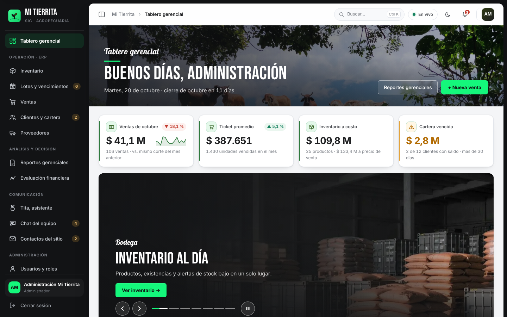

# UNIVERSIDAD DE CARTAGENA
## Ingeniería de Software · Sistemas de Información Gerencial (AL17705) · Ingeniería Económica
### Trabajo Colaborativo Contextualizado · 2026-2

---

# Mi Tierrita SIG · API
## Sistema de Información Gerencial de Agropecuaria Mi Tierrita (Sahagún, Córdoba)


Servidor REST de **Mi Tierrita SIG**: inventario con lotes y vencimientos (FEFO), punto de venta, clientes con
cartera, proveedores, usuarios y roles, auditoría, reportes gerenciales y el motor financiero que evalúa la
ampliación del local. Lo consume la aplicación web
[`mi-tierrita-app`](https://github.com/kariredondos2002/mi-tierrita-app).



---

## Tabla de Contenidos

1. [Descripción](#descripción)
2. [Marco Teórico](#marco-teórico)
3. [Funcionalidades](#funcionalidades)
4. [Roles y Permisos](#roles-y-permisos)
5. [Arquitectura y Diseño](#arquitectura-y-diseño)
6. [Tecnologías](#tecnologías)
7. [Estructura del Proyecto](#estructura-del-proyecto)
8. [Instalación y Ejecución](#instalación-y-ejecución)
9. [Variables de Entorno](#variables-de-entorno)
10. [Base de Datos](#base-de-datos)
11. [API REST](#api-rest)
12. [Eventos Socket.io](#eventos-socketio)
13. [Reportes en PDF y Excel](#reportes-en-pdf-y-excel-y-su-auditoría-v42)
14. [Códigos de Error](#códigos-de-error)
15. [Seguridad](#seguridad)
16. [Pruebas](#pruebas)
17. [Despliegue en Seenode](#despliegue-en-seenode)
18. [Solución de Problemas](#solución-de-problemas)
19. [Decisiones Pendientes con el Negocio](#decisiones-pendientes-con-el-negocio)
20. [Fases del Desarrollo](#fases-del-desarrollo)
21. [Autores](#autores)
22. [Notas Académicas](#notas-académicas)

---

## Descripción

El negocio facturaba con un software que solo emite la factura electrónica: no había lotes ni vencimientos, la
cartera estaba en un cuaderno y la gerencia evaluaba un crédito para ampliar el local sin cifras. Esta API es el
núcleo del SIG: guarda la operación diaria con sus reglas (FEFO, cupo de crédito, anulaciones, auditoría), la agrega
en reportes y calcula los indicadores de la inversión (VPN, TIR, cobertura de la cuota, sensibilidad).

Desde la versión 4 la API también es un servidor **Socket.io**: el equipo (administración, caja y bodega) conversa
en un canal general y en privados con historial, «está escribiendo…» y presencia; los eventos del negocio (ventas,
abonos, compras, stock bajo, escenarios, contactos) llegan como notificaciones en vivo, y cualquier cambio refresca las
pantallas abiertas de los demás sin recargar. Desde la **v4.5** el chat guarda recibos por persona (enviado, entregado,
visto; el detalle lo ve solo el autor), citas, hilos, fijados, menciones, adjuntos y audio, sin duplicar mensajes gracias
a `clientId`. La API también aloja a **Tita**, un asistente con IA opcional (Claude, de Anthropic) que consulta datos
del negocio y prepara borradores que la persona confirma. La página pública de inicio guarda los mensajes de su
formulario de contacto. Los reportes en PDF y Excel (v4.2 y v4.4) se generan en el servidor y quedan auditados.

Implementa la documentación técnica del TCC: arquitectura del backend (01), requisitos (03), casos de uso (04),
modelo de datos (05), diseño de la API (06) e infraestructura del backend (08).

---

## Marco Teórico

### API REST sin estado

Cada petición lleva todo lo necesario para atenderla: el recurso en la URL, la acción en el método HTTP y la
identidad en el token. El servidor no guarda sesiones, así que puede reiniciarse o replicarse sin perder nada.

### Arquitectura por capas

Una petición recorre `routes → controllers → business-logic → data-sources → PostgreSQL` y ninguna capa se salta a
otra. Cada capa tiene un solo motivo de cambio: las rutas cablean y autorizan, los controladores solo entienden HTTP,
la lógica de negocio contiene reglas y SQL y la capa de datos maneja el pool y las transacciones.

### Autenticación con JWT

Al iniciar sesión el servidor verifica la contraseña (bcrypt) y firma un token HS256 con el usuario, su rol y una
versión de token. Al cerrar sesión o cambiar la contraseña la versión sube y los tokens anteriores dejan de servir.

### Consistencia con transacciones y bloqueo de fila

Una venta toca varias tablas (venta, líneas, lotes, stock, saldo del cliente). Todo ocurre en **una transacción**:
si algo falla, nada queda a medias. Los contadores que comparten varias cajas (`products.stock`,
`customers.balance`) se bloquean con `SELECT … FOR UPDATE` para que dos ventas simultáneas no vendan lo mismo.

### FEFO (primero en vencer, primero en salir)

En productos con vencimiento el orden de entrada no sirve: una venta descuenta del lote que **vence primero**,
salta los vencidos y puede repartir la cantidad entre varios lotes; la asignación queda guardada para poder anularla.

### Tiempo real con WebSocket (Socket.io)

HTTP es petición-respuesta: el servidor no puede avisar por iniciativa propia. Un WebSocket mantiene una conexión
abierta y bidireccional; **Socket.io** agrega sobre ella reconexión automática, salas (*rooms*), confirmaciones
(*acks*) y respaldo por *long polling*. El servidor agrupa los sockets en salas (`canal:general`, `usuario:<id>`,
`rol:<ROL>`) y emite a una sala sin saber qué pestañas la forman. El patrón **emisor desacoplado** (tomado de
SoftUnity) deja que la lógica de negocio publique eventos sin depender de Express ni de Socket.io.

### Evaluación financiera

El motor (`business-logic/financial/engine.ts`) es un porte uno a uno del modelo de Ingeniería Económica: flujo de
caja proyectado, amortización del crédito, VPN, TIR, periodo de recuperación, cobertura incremental de la cuota,
sensibilidad univariada y bivariada y diagrama de tornado.

---

## Funcionalidades

| Módulo | Qué hace | RF / CU |
|---|---|---|
| Autenticación | Inicio y cierre de sesión, perfil, límite de 10 intentos cada 15 min | RF-01 · CU-01, CU-02 |
| Usuarios | Alta por el administrador (no hay registro público), consulta, cambio de la propia contraseña | RF-01 · CU-03, CU-04 |
| Categorías y productos | Líneas de producto, precio, stock mínimo, desactivación | RF-02 · CU-05 |
| Lotes | Registro con cantidad, costo y vencimiento; lotes por vencer y vencidos | RF-02.6 · CU-06, CU-07 |
| Ventas | Contado o crédito, FEFO, precio congelado, total calculado en el servidor, factura correlativa, anulación | RF-03 · CU-08 a CU-11 |
| Clientes y cartera | Cupo, saldo, abonos, cartera vencida | RF-04 · CU-12 |
| Proveedores | Ficha y compras que crean el lote | RF-05 · CU-13 |
| Evaluación financiera | Escenarios, comparación, amortización, sensibilidad, bivariada y tornado | RF-06 · CU-14 a CU-17 |
| Auditoría | Toda escritura exitosa con usuario, método, recurso y fecha; además cada reporte descargado (`EXPORT`) y cada inicio de sesión (`SIGNIN`) con su detalle | RF-09 · CU-18 |
| Reportes | Ventas por periodo, inventario por vencer y bajo mínimo, cartera | RF-08 · CU-19, CU-20 |
| Reportes en PDF y Excel (v4.2) | Ventas, inventario, cartera y evaluación financiera en **PDF con gráficos** (barras, torta, tornado, indicadores) o **Excel con hojas formateadas**; el encabezado dice quién lo generó y cuándo, y la descarga queda en la auditoría | `/reports/*/export` |
| Chat del equipo (v4 · v4.5) | Canal general y privados, historial paginado, «está escribiendo…», presencia y última conexión, respaldo REST. **v4.5:** recibos por persona (el detalle es solo del autor), citas, hilos, responder en privado, fijados, @menciones, adjuntos (6 MB), audio, búsqueda, no leídos y `clientId` contra duplicados | Socket.io · `/chat/*` |
| Notificaciones (v4) | Venta, anulación, abono, compra o lote, stock bajo (≤ 5), nuevo escenario y nuevo contacto; guardadas y empujadas en vivo | Socket.io |
| Actualización en vivo (v4) | `datos:cambio` tras cada escritura: las demás pestañas refrescan solo lo que cambió | Socket.io |
| Búsqueda global (v4) | Productos, clientes, proveedores, ventas y personas según el rol (Ctrl + K) | `GET /search` |
| Mi perfil (v4.2) | Nombre, apellido, correo y teléfono propios; cambio de contraseña; mi actividad de los últimos 30 días | `PUT /users/me` · `GET /users/me/activity` |
| Contacto público (v4) | Formulario de la página de inicio (5 envíos por hora por IP) y bandeja del administrador | `/contact` |
| Tita, asistente con IA | Resumen del día por rol, conversación con herramientas de consulta y de acción que la persona confirma, borradores y lectura de facturas. Opcional: sin `ANTHROPIC_API_KEY` la API responde 660 y la app oculta la IA | `/ai/status` · `/ai/briefing` · `/ai/chat` · `/ai/drafts` · `/ai/invoice` |
| Salud y documentación | `GET /health` y Swagger UI en `/docs` | RNF |

---

## Roles y Permisos

| Recurso | ADMIN (Administrador) | SALES (Secretaria) | WAREHOUSE (Bodega) |
|---|:---:|:---:|:---:|
| Usuarios | ✔ | solo su contraseña | solo su contraseña |
| Productos y categorías: consultar | ✔ | ✔ | ✔ |
| Productos y categorías: crear y editar | ✔ | — | ✔ |
| Desactivar producto · eliminar categoría | ✔ | — | — |
| Lotes por vencer · registrar lotes | ✔ | — | ✔ |
| Ventas: registrar y consultar | ✔ | ✔ | — |
| Anular venta | ✔ | — | — |
| Clientes, cartera y abonos | ✔ | ✔ | — |
| Proveedores y compras | ✔ | consulta | ✔ |
| Evaluación financiera | ✔ | — | — |
| Reporte de ventas | ✔ | ✔ | — |
| Reportes de inventario y cartera | ✔ | — | — |
| Auditoría | ✔ | — | — |
| Chat, notificaciones, búsqueda y perfil propio | ✔ | ✔ | ✔ |
| Bandeja de contactos del sitio | ✔ | — | — |
| Tita: resumen, conversación y borradores | ✔ | ✔ (según sus permisos) | ✔ (según sus permisos) |
| Tita: leer una factura de compra | ✔ | — | ✔ |

Un rol sin permiso recibe **403** con el código 613 y los roles requeridos.

---

## Arquitectura y Diseño

### Capas del servidor

```
+-------------------------------------------------------------------------+
|  routes/          una ruta = método + ruta + authorize(roles) + controlador |
+-----------------------------------+-------------------------------------+
                                    |
+-----------------------------------v-------------------------------------+
|  controllers/     solo HTTP: parsea la entrada (parseX), llama a la      |
|                   lógica y responde con toXResponse                      |
+-----------------------------------+-------------------------------------+
                                    |
+-----------------------------------v-------------------------------------+
|  business-logic/  reglas del dominio y SQL, un archivo por operación     |
|                   (sales/register-sale.ts aplica FEFO, cupo y factura)        |
+-----------------------------------+-------------------------------------+
                                    |
+-----------------------------------v-------------------------------------+
|  data-sources/    pool de PostgreSQL, transacciones, errores de la base  |
+-----------------------------------+-------------------------------------+
                                    |
                               PostgreSQL 16
```

### Patrones aplicados

| Patrón | Dónde | Para qué |
|---|---|---|
| Capas | Todo `src/` | Separar HTTP, dominio y datos |
| DTO + mapeador | `models/` (`parseX`, `toXResponse`) | La fila guardada nunca cruza la frontera HTTP (sin contraseñas ni versiones de token) |
| Unidad de trabajo | `data-sources/db.ts` (`transaction`) | Una operación = una transacción |
| Middleware | `security/`, `server/` | Autenticación, autorización, auditoría y errores en un solo lugar |
| Error de dominio | `common/errors.ts` | La lógica lanza un código; el manejador único lo traduce a HTTP |
| Repositorio de migraciones | `migrations/` | Esquema versionado y reproducible |

### Flujo de una venta a crédito

```
POST /sales  (token de la Secretaria)
  → authenticate → authorize(ADMIN, SALES)
  → controller: parseRegisterSale(body)      cantidades y producto; el precio y el total del cliente se ignoran
  → business-logic/sales/register-sale.ts
       BEGIN
       SELECT cliente FOR UPDATE              ¿activo? ¿saldo + total ≤ cupo?  si no → 621
       SELECT producto FOR UPDATE             ¿activo? ¿stock suficiente?      si no → 620
       lotes no vencidos ORDER BY vencimiento → asigna cantidad (FEFO)
       INSERT venta, líneas y asignaciones;  stock −,  saldo +
       factura FV-AAAA-NNNNNN (contador anual con bloqueo)
       COMMIT
  → middleware de auditoría registra la escritura
  → 201 con la venta completa
```

### Tiempo real: Socket.io sobre el mismo servidor

```
                 ┌──────────────── servidor HTTP :4300 ────────────────┐
  pestañas ──────┤  Express  /api/v1 …  (REST + auditoría + datos:cambio)│
  (JWT)          │  Socket.io /socket.io                                 │
                 │     io.use(auth JWT) → join canal:general,            │
                 │                         usuario:<id>, rol:<ROL>       │
                 │     chat-handler: chat:mensaje · chat:privado ·       │
                 │                   chat:leido · chat:fijar · escribiendo │
                 │     presence: Map usuario → Set<socketId>             │
                 └──────────────┬────────────────────────────────────────┘
                                │ emitter.ts (emitToAll / emitToUsers / emitToRoles)
            business-logic: chat/deliver · notifications/business-events
```

Diagramas (arquitectura, capas, despliegue, modelo de datos, secuencias de chat y reconexión, salas de Socket.io)
en [FigJam](https://www.figma.com/board/aPQbmmGEGvT4ScW7g9Y7h9), D01–D40.

---

## Tecnologías

| Componente | Versión | Uso |
|---|---|---|
| Node.js | 22 LTS | Entorno de ejecución |
| TypeScript | 5.9 | Tipado estricto (CommonJS) |
| Express | 5 | Servidor HTTP |
| pg | 8 | Cliente de PostgreSQL (sin ORM) |
| PostgreSQL | 16 (18 compatible) | Base de datos |
| jsonwebtoken · bcryptjs | 9 · 3 | Tokens y contraseñas |
| helmet · cors · express-rate-limit | 8 · 2 · 8 | Cabeceras seguras, orígenes permitidos, límite de intentos |
| socket.io | 4.8 | Chat, presencia, notificaciones y actualización en vivo |
| @anthropic-ai/sdk | 0.131 | Cliente de Claude para Tita (opcional, v4.5) |
| pdfkit · exceljs | 0.17 · 4 | Reportes en PDF con gráficos vectoriales y libros de Excel (v4.2) |
| swagger-ui-express | 5 | Documentación interactiva en `/docs` |
| tsx | 4 | Desarrollo con recarga y scripts |
| node:test | integrado | Pruebas |

---

## Estructura del Proyecto

```
mi-tierrita-api/
├── src/
│   ├── server/            arranque, configuración, manejador de errores, auditoría
│   ├── security/          roles, bcrypt, JWT, authenticate y authorize
│   ├── routes/            un archivo por entidad (cableado + roles)
│   ├── controllers/       un archivo por operación
│   ├── business-logic/    reglas y SQL por entidad (sales, customers, financial/engine.ts, chat,
│   │                      notifications, search, contact, ai/ = Tita, exports/ = PDF y Excel…)
│   ├── models/            tipos, parseX y toXResponse (realtime.ts: chat, notificaciones, contacto)
│   ├── sockets/           index (JWT + salas) · chat-handler · presence · emitter
│   ├── data-sources/      pool, transacciones, errores de PostgreSQL
│   ├── common/            códigos de error, paginación, validador, fechas
│   └── scripts/           migrate · create-admin · seed-demo
├── migrations/            SQL numerado y versionado
├── docs/
│   ├── openapi.yaml       contrato de los 81 endpoints REST (incluye chat v4.5 y Tita)
│   └── DESPLIEGUE.md      guía de Seenode paso a paso
├── tests/                 55 pruebas (53 pasan, 2 omitidas)
├── Dockerfile · docker-compose.yml
└── .env.example
```

---

## Instalación y Ejecución

### Requisitos

| Programa | Versión |
|---|---|
| Node.js | 22 LTS (20.19 o superior) |
| pnpm | 10 (`corepack enable`) |
| PostgreSQL | 16, 17 o 18 (o Docker) |
| Git | cualquiera reciente |

### 1. Clonar los repositorios

Los repositorios son privados; pida acceso a la cuenta `kariredondos2002`.

```bash
mkdir "Mi Tierrita"
cd "Mi Tierrita"
git clone https://github.com/kariredondos2002/mi-tierrita-api.git
git clone https://github.com/kariredondos2002/mi-tierrita-app.git
```

### 2. Instalar dependencias

```bash
cd mi-tierrita-api
corepack enable
pnpm install
```

### 3. Configurar el archivo `.env`

```bash
# Windows (CMD)
copy .env.example .env
# Windows (PowerShell), Linux o macOS
cp .env.example .env
```

Abra `.env` y escriba los datos de su PostgreSQL (o deje los de Docker) y un `JWT_SECRET` de 32 caracteres o más.

### 4. Crear la base de datos

Con Docker:

```bash
docker compose up -d db          # PostgreSQL 16 en localhost:5433 (usuario, clave y base: mi_tierrita)
```

Con PostgreSQL instalado:

```bash
psql -U postgres -c "CREATE USER mi_tierrita WITH PASSWORD 'mi_tierrita';"
psql -U postgres -c "CREATE DATABASE mi_tierrita OWNER mi_tierrita;"
```

### 5. Crear las tablas y cargar los datos de demostración

```bash
pnpm db:migrate
pnpm db:seed                     # 120 días de datos simulados (solo si la base está vacía)
# o, sin demo:  pnpm create-admin admin "una-clave-segura"
```

### 6. Ejecutar el servidor

```bash
pnpm dev
```

```
Mi Tierrita API escuchando en http://localhost:4300/api/v1
Documentación OpenAPI en http://localhost:4300/docs
```

### 7. Ejecutar la aplicación web

Siga el README de [`mi-tierrita-app`](https://github.com/kariredondos2002/mi-tierrita-app#instalación-y-ejecución)
(`pnpm install` y `pnpm dev` en la otra carpeta) y abra http://localhost:5173.

### Opción rápida en Windows

| Archivo | Qué hace |
|---|---|
| `INICIAR-MI-TIERRITA.bat` | Inicia PostgreSQL, instala, migra, siembra y abre la API y la aplicación |
| `ACTUALIZAR-MI-TIERRITA.bat` | Trae la última versión, la sube a GitHub y reinicia |
| `SUBIR-A-GITHUB.bat` | Conecta los repositorios con la cuenta `kariredondos2002` y los sube |

### Scripts

| Script | Descripción |
|---|---|
| `pnpm dev` | Servidor con recarga (`tsx watch`), puerto 4300 |
| `pnpm build` · `pnpm start` | Compila a `build/` y ejecuta |
| `pnpm typecheck` | Verificación de tipos |
| `pnpm test` | Pruebas (las de chat avanzado usan PostgreSQL real y se omiten si no hay base) |
| `pnpm db:migrate` · `pnpm db:status` | Aplica o lista las migraciones |
| `pnpm db:seed` | Siembra los datos de demostración |
| `pnpm create-admin <usuario> <clave>` | Crea el primer administrador |
| `pnpm start:seenode` | Producción: migra, siembra si `SEED_DEMO=true` y arranca |

### Usuarios de prueba

Los crea `pnpm db:seed`:

| Usuario | Rol | Contraseña |
|---|---|---|
| `admin` | ADMIN · Administrador | `MiTierrita2026` |
| `secretaria` | SALES · Secretaria | `MiTierrita2026` |
| `bodega` | WAREHOUSE · Bodega | `MiTierrita2026` |

---

## Variables de Entorno

| Variable | Ejemplo | Descripción |
|---|---|---|
| `PORT` | `4300` | Puerto del proceso |
| `DB_HOST` · `DB_PORT` · `DB_NAME` · `DB_USER` · `DB_PASSWORD` | `localhost` · `5433` · `mi_tierrita`… | Conexión local a PostgreSQL |
| `DATABASE_URL` | `postgres://u:c@host:5432/base` | Cadena del Postgres gestionado; si existe, reemplaza a las cinco anteriores |
| `DB_SSL` | `require` | TLS de la conexión: `disable`, `require` o `verify` |
| `JWT_SECRET` | 32+ caracteres aleatorios | Firma de los tokens; sin valor por defecto en producción |
| `JWT_EXPIRES_IN` | `8h` | Vigencia del token |
| `CORS_ORIGINS` | `http://localhost:5173` | Dominios del frontend permitidos, separados por coma |
| `ANTHROPIC_API_KEY` | vacío | Clave de Claude (Anthropic) para Tita. Opcional |
| `AI_MODEL` / `AI_FAST_MODEL` | `claude-sonnet-5-5` / `claude-haiku-5-5` | Modelo de Tita y de los textos cortos |
| `SEED_DEMO` | `true` | (Seenode) siembra la demo al arrancar si la base está vacía |

Ningún valor sensible va en el código, en la imagen ni en el repositorio.

---

## Base de Datos

| Tabla | Contenido |
|---|---|
| `roles` · `users` | Roles fijos y usuarios con contraseña bcrypt y versión de token |
| `categories` · `products` | Líneas y productos con precio, stock y stock mínimo |
| `product_batches` | Lotes con cantidad inicial y restante, costo, vencimiento y proveedor |
| `suppliers` | Proveedores |
| `customers` · `customer_payments` | Clientes con cupo y saldo; abonos |
| `sales` · `sale_lines` · `sale_line_batch_allocations` | Venta, líneas con precio congelado y de qué lote salió cada unidad |
| `invoice_counters` | Correlativo de factura por año |
| `audits` | Bitácora de escrituras |
| `financial_scenarios` · `financial_scenario_cash_flows` · `financial_scenario_amortization` | Escenarios con supuestos, indicadores, flujo y amortización guardados |
| `messages` (v4) | Chat: canal general (`recipient_id` nulo) y privados, con `read_at` para el doble check |
| `notifications` (v4) | Avisos por usuario: tipo, texto, enlace y leída |
| `contact_messages` (v4) | Formulario de la página pública y si ya se atendió |
| `users.last_seen_at` (v4) | Última conexión, al cerrar el último socket del usuario |
| `users.email` · `phone` · `updated_at` (v4.2, migración 0003) | Datos de contacto editables en Mi perfil; correo único sin distinguir mayúsculas |
| `audits.detail` (v4.2, migración 0003) | Qué reporte se generó, con qué filtros y formato, o desde qué IP se inició sesión |
| `audits.ai_suggested` (v4.5, migración 0004) | Marca las escrituras que la persona confirmó a partir de un borrador de Tita; quien firma sigue siendo la persona |
| `messages` ampliada · `message_receipts` · `message_mentions` · `message_attachments` (v4.5, migración 0005) | Tipo de mensaje (texto, audio, archivo), cita, hilo, `client_id` contra duplicados, fijado; recibos por persona (enviado, entregado, visto), menciones y adjuntos de hasta 6 MB |
| `contact_messages.topic` · `email` opcional (v4.5, migración 0006) | Basta un teléfono o un correo para poder responder; asunto elegido en el formulario |

### Reglas de integridad

- Dinero del negocio en `DECIMAL(12,2)`; el módulo financiero en `DOUBLE PRECISION`.
- Claves foráneas sin borrado en cascada: no se borra un producto con ventas ni una categoría con productos (631); los productos se desactivan.
- `CHECK` de precios, cantidades y existencias no negativas; únicos el usuario, el SKU del producto, el nombre de la categoría, el documento del cliente y el número de factura (630).
- Una venta anulada no se borra: queda `VOIDED` con fecha y usuario.

### Comandos útiles

```bash
pnpm db:status                                   # migraciones aplicadas y pendientes
psql -h localhost -p 5433 -U mi_tierrita mi_tierrita -c "SELECT code, name, stock FROM products ORDER BY stock LIMIT 10;"
```

---

## API REST

Base: `http://localhost:4300/api/v1` · Todo excepto `POST /auth/signin`, `POST /contact` y `GET /health` exige
`Authorization: Bearer <token>`. Los listados aceptan `?page=` y `?limit=` (10, máximo 100) y responden
`{ count, page, pages, items }`. Contrato completo en `docs/openapi.yaml` y en **/docs**.

### Autenticación y usuarios

| Método | Ruta | Roles | Descripción |
|---|---|---|---|
| POST | `/auth/signin` | público | Inicia sesión y devuelve el token |
| POST | `/auth/signout` | todos | Invalida los tokens del usuario |
| GET | `/auth/me` | todos | Perfil y rol |
| POST · GET | `/users` | ADMIN | Crear y listar usuarios |
| GET | `/users/:id` | ADMIN | Detalle |
| PUT | `/users/me/password` | todos | Cambiar la propia contraseña |

### Inventario y lotes

| Método | Ruta | Roles | Descripción |
|---|---|---|---|
| POST · GET | `/categories` | crear: ADMIN, WAREHOUSE · listar: todos | Líneas de producto |
| PUT · DELETE | `/categories/:id` | ADMIN, WAREHOUSE · borrar: ADMIN | Editar o eliminar |
| POST · GET | `/products` | crear: ADMIN, WAREHOUSE · listar: todos | Productos |
| GET · PUT · DELETE | `/products/:id` | ver: todos · editar: ADMIN, WAREHOUSE · desactivar: ADMIN | Detalle, edición, desactivación |
| POST · GET | `/products/:id/batches` | registrar: ADMIN, WAREHOUSE · ver: todos | Lotes del producto |
| GET | `/batches/expiring?days=30` | ADMIN, WAREHOUSE | Lotes vencidos y por vencer |

### Ventas, clientes y proveedores

| Método | Ruta | Roles | Descripción |
|---|---|---|---|
| POST · GET | `/sales` | ADMIN, SALES | Registrar (FEFO, cupo, factura) y listar |
| GET | `/sales/:id` | ADMIN, SALES | Detalle con lotes asignados |
| POST | `/sales/:id/void` | ADMIN | Anular |
| POST · GET | `/customers` | ADMIN, SALES | Crear y listar clientes |
| GET · PUT | `/customers/:id` | ADMIN, SALES | Detalle y edición |
| GET | `/customers/:id/balance` | ADMIN, SALES | Saldo, cupo disponible y movimientos |
| POST | `/customers/:id/payments` | ADMIN, SALES | Registrar abono |
| POST · GET | `/suppliers` | crear: ADMIN, WAREHOUSE · listar: todos | Proveedores |
| PUT | `/suppliers/:id` | ADMIN, WAREHOUSE | Editar |
| POST | `/suppliers/:id/purchases` | ADMIN, WAREHOUSE | Compra que crea el lote |

### Evaluación financiera, reportes y auditoría

| Método | Ruta | Roles | Descripción |
|---|---|---|---|
| POST · GET | `/financial/scenarios` | ADMIN | Crear (calcula y guarda indicadores) y listar |
| GET | `/financial/scenarios/compare?ids=1,2` | ADMIN | Comparar escenarios |
| GET | `/financial/scenarios/:id` | ADMIN | Supuestos, indicadores y flujo |
| GET | `/financial/scenarios/:id/amortization` | ADMIN | Tabla de amortización |
| GET | `/financial/scenarios/:id/sensitivity` | ADMIN | Sensibilidad de una variable |
| GET | `/financial/scenarios/:id/sensitivity/bivariate` | ADMIN | Grilla de dos variables |
| GET | `/financial/scenarios/:id/tornado` | ADMIN | Diagrama de tornado |
| GET | `/reports/sales?from&to&groupBy` | ADMIN, SALES | Ventas por día, semana o mes |
| GET | `/reports/inventory?days=30` | ADMIN | Inventario por vencer y bajo mínimo |
| GET | `/reports/receivables?overdueDays=30` | ADMIN | Cartera y cartera vencida |
| GET | `/reports/sales/export?format=pdf\|xlsx&from&to&groupBy` | ADMIN, SALES | Descargar ventas en PDF o Excel (v4.2) |
| GET | `/reports/inventory/export?format&days` | ADMIN | Descargar inventario (v4.2) |
| GET | `/reports/receivables/export?format&overdueDays` | ADMIN | Descargar cartera (v4.2) |
| GET | `/financial/scenarios/:id/export?format` | ADMIN | Descargar la evaluación del escenario (v4.2) |
| GET | `/reports/exports` | ADMIN (todos) · SALES (los suyos) | Historial de reportes generados: quién, cuál y cuándo (v4.2) |
| GET | `/audits?method=EXPORT\|SIGNIN\|POST…` | ADMIN | Bitácora, filtrable por tipo de acción |
| GET | `/health` · `/docs` | público | Salud y Swagger |

### Tiempo real, búsqueda, perfil y contacto (v4)

| Método | Ruta | Roles | Descripción |
|---|---|---|---|
| GET · POST | `/chat/general?before&limit` | todos | Historial del canal general · enviar (respaldo de `chat:mensaje`) |
| GET | `/chat/conversations` | todos | Privadas con último mensaje y no leídos |
| GET | `/chat/people` · `/chat/online` · `/chat/unread` | todos | Directorio con última conexión · en línea · sin leer (`unread`, `general`, `privates`, `mentions`) |
| POST | `/chat/messages` | todos | Envío completo (v4.5): texto, `replyToId` (cita), `threadRootId` (hilo), `attachmentId`, `clientId` (evita duplicados) y `recipientId` (privado) |
| GET | `/chat/messages/:id/receipts` | autor | Quién recibió, quién vio y quién sigue pendiente (613 si no es el autor) |
| GET | `/chat/messages/:id/thread` · PUT `/chat/messages/:id/pin` `{pinned}` | participantes · ADMIN en el general | Hilo con sus respuestas · fijar o desfijar |
| GET | `/chat/pinned?scope` · `/chat/search?q&scope&limit` | todos | Fijados · búsqueda solo entre lo que la persona puede ver |
| POST · GET | `/chat/attachments` · `/chat/attachments/:id` | todos | Subir (cuerpo binario, `X-File-Name`, `X-Duration-Ms`; 6 MB; imágenes, PDF, Office, texto y audio) · descargar con permisos |
| POST | `/chat/general/read` | todos | Marcar visto el canal general |
| GET · POST | `/chat/private/:userId` | todos | Historial privado · enviar (respaldo de `chat:privado`) |
| POST | `/chat/private/:userId/read` | todos | Marcar como leída (emite `chat:leido`) |
| GET | `/notifications` | todos | Últimas 30 y total sin leer |
| POST | `/notifications/read` | todos | Marcar leídas (`{ids}` o todas) |
| GET | `/search?q=` | todos (filtrado por rol) | Búsqueda global |
| PUT | `/users/me` | todos | Nombre, apellido, correo y teléfono propios (409 · 630 si el correo ya existe) |
| GET | `/users/me/activity` | todos | Mis últimas acciones y conteos de 30 días (v4.2) |
| POST | `/contact` | **público** · 5/h por IP | Formulario de la página de inicio |
| GET · POST | `/contact` · `/contact/:id/handled` | ADMIN | Bandeja y marcar atendido |
| GET · POST | `/ai/status` · `/ai/briefing` · `/ai/chat` · `/ai/drafts` · `/ai/invoice` | según rol | Tita: las acciones no escriben; la app las ejecuta si la persona confirma (cabecera `X-AI-Suggested`) |

### Ejemplo con curl

```bash
# 1. Iniciar sesión y guardar el token
TOKEN=$(curl -s -X POST http://localhost:4300/api/v1/auth/signin \
  -H "Content-Type: application/json" \
  -d '{"username":"secretaria","password":"MiTierrita2026"}' | jq -r .token)

# 2. Lotes que vencen en 15 días (como bodega o admin)
curl -s "http://localhost:4300/api/v1/batches/expiring?days=15" -H "Authorization: Bearer $TOKEN"

# 3. Venta a crédito
curl -s -X POST http://localhost:4300/api/v1/sales -H "Authorization: Bearer $TOKEN" \
  -H "Content-Type: application/json" \
  -d '{"paymentType":"CREDIT","customerId":3,"lines":[{"productId":7,"quantity":2}]}'
```

---

## Eventos Socket.io

Conexión: `io("http://localhost:4300", { auth: { token } })`, el mismo JWT del REST. Un token inválido o de una
sesión cerrada se rechaza con `connect_error` `611`; un usuario inactivo con `612`. Cada evento del cliente responde
por *ack* `{ ok: true, … }` o `{ ok: false, error: "<código>" }`. Límite: 12 mensajes cada 10 s por socket (`640`).

**Cliente → servidor**

| Evento | Datos | Ack | Efecto |
|---|---|---|---|
| `chat:mensaje` | `"texto"` o `{ content?, replyToId?, threadRootId?, attachmentId?, clientId? }` | `{ ok, message }` | Guarda y emite `chat:mensaje` a `canal:general`; un `clientId` repetido devuelve el mismo mensaje (sin duplicados) |
| `chat:privado` | `{ recipientId, content?, replyToId?, threadRootId?, attachmentId?, clientId? }` | `{ ok, message }` | Guarda y emite `chat:privado` a `usuario:<emisor>` y `usuario:<receptor>` (también sirve para «responder en privado» citando un mensaje del grupo, sin publicar nada en él) |
| `chat:leido` | `{ userId }` o `{ scope: "general" }` | `{ ok, updated }` | Marca visto y emite `chat:leido` y `chat:recibos` |
| `chat:fijar` | `{ messageId, pinned }` | `{ ok, message }` | Fija o desfija (en el general solo ADMIN) y emite `chat:fijado` |
| `chat:escribiendo` | `{ recipientId \| null, typing }` | — | Reenvía a la sala general o solo al destinatario |

**Servidor → cliente**

| Evento | Sala | Datos |
|---|---|---|
| `chat:historial` | el socket que se conecta | `{ messages, hasMore }` (últimos 40 del canal general) |
| `chat:mensaje` · `chat:privado` | general · emisor y receptor | `Message` |
| `chat:leido` | lector (y la otra persona en privado) | `{ readerId, scope, otherId?, at }` |
| `chat:recibos` | autor del mensaje | `{ updates: [{ messageId, total, delivered, read }] }` — alimenta los chulitos ✓ enviado · ✓✓ entregado · ✓✓ azul visto |
| `chat:fijado` | general o los dos de un privado | `Message` (con `pinnedAt`) |
| `chat:escribiendo` | general o destinatario | `{ from, recipientId, typing }` |
| `usuarios:conectados` | el socket que se conecta | `Person[]` |
| `usuario:conectado` · `usuario:desconectado` | general | `Person` · `{ id, lastSeenAt }` |
| `notificacion` | `usuario:<id>` | `Notification` (también queda en la tabla) |
| `datos:cambio` | general | `{ resource, actorId, at }` — `products`, `batches`, `sales`, `customers`, `suppliers`, `financial`… |

Quién recibe cada notificación:

| Evento de negocio | Destinatarios (sin el autor) |
|---|---|
| Venta registrada | Administradores |
| Producto con 5 unidades o menos después de una venta | Administradores y bodega |
| Venta anulada | Administradores y secretarias |
| Abono | Administradores |
| Compra o lote registrado | Administradores y bodega |
| Escenario financiero nuevo | Administradores |
| Mensaje de contacto del sitio | Administradores |

---

## Reportes en PDF y Excel y su auditoría (v4.2 y v4.4)

Cada reporte se descarga como **PDF** (por defecto) o **Excel** con `?format=pdf|xlsx`. Los genera el servidor
(`business-logic/exports/`) con los mismos datos de la pantalla, así que lo que se ve es lo que se imprime.

| Reporte | PDF | Excel |
|---|---|---|
| Ventas | Indicadores, barras por día, torta contado/crédito, 10 productos más vendidos, detalle | Hojas *Resumen*, *Por día* y *Por producto* |
| Inventario | Indicadores, valor por línea, participación, detalle | Hoja por línea con totales |
| Cartera | Indicadores, saldo por cliente (vencidos en rojo), detalle | Hoja de clientes con cupo, uso y estado |
| Escenario financiero | VPN, TIR, cuota, cobertura, veredicto, flujo por año y tornado | Indicadores, flujo y sensibilidad |

**Plantilla común (v4.4).** Todos los PDF salen de `pdf-theme.ts` + `report-pdf.ts`: encabezado institucional con
periodo, alcance, fecha y autor; resumen ejecutivo; tarjetas de indicadores; gráficos de barras, barras horizontales,
dona y línea con título y unidad; tablas con encabezado repetido, totales y etiquetas de estado; hallazgos y pendientes
calculados con los datos; criterios de cálculo y «Página X de Y». Los Excel (`report-xlsx.ts`) usan el mismo lenguaje, con
totales por fórmula e impresión ajustada. Se distingue **0**, **N/D** (no disponible), **N/A** (no aplica) y
**Sin registro**; cada reporte es una lista de bloques que se pueden ocultar o reordenar. `report-files.ts` solo
consulta los datos.

**Auditoría de quién genera cada reporte.** El encabezado del PDF y la primera fila del Excel dicen
*«Generado por Nombre (@usuario) el 9 de octubre de 2026, 5:10 p. m.»*, y cada descarga guarda una fila en
`audits` con `method = 'EXPORT'`, la ruta y un `detail` legible (*«Reporte de ventas · PDF · 2026-09-10 a
2026-10-09 · por día»*). `GET /reports/exports` muestra ese historial: el administrador ve el de todos y la
secretaria solo el suyo. Los inicios de sesión se registran igual con `method = 'SIGNIN'` y la IP.

---

## Códigos de Error

Toda respuesta de error es `{ "message": "<código>" }` (más `details` en un 400). La aplicación traduce cada código
a un mensaje claro.

| Código | Significado | HTTP |
|---|---|---|
| 400 | Datos de entrada mal formados (trae `details`) | 400 |
| 404 | Ruta inexistente | 404 |
| 500 | Error interno | 500 |
| 601 | Producto no encontrado | 404 |
| 602 | Categoría no encontrada | 404 |
| 603 | Usuario no encontrado | 404 |
| 604 | Cliente no encontrado | 404 |
| 605 | Proveedor no encontrado | 404 |
| 606 | Venta no encontrada | 404 |
| 607 | Escenario financiero no encontrado | 404 |
| 610 | Credenciales inválidas | 401 |
| 611 | Token ausente o inválido | 401 |
| 612 | Usuario inactivo | 401 |
| 613 | Rol insuficiente (trae `requiredRoles`) | 403 |
| 620 | Stock insuficiente (trae `available`) | 409 |
| 621 | Cupo de crédito excedido | 409 |
| 622 | La venta ya estaba anulada | 409 |
| 623 | Abono mayor al saldo de cartera | 409 |
| 625 | Producto inactivo | 409 |
| 608 | Mensaje de contacto no encontrado | 404 |
| 626 | Cliente inactivo | 409 |
| 630 | Recurso duplicado | 409 |
| 631 | Categoría con productos asociados | 409 |
| 640 | Demasiados intentos de acceso | 429 |
| 609 | Mensaje no encontrado o que la persona no puede ver | 404 |
| 660 | IA no configurada (falta `ANTHROPIC_API_KEY`) | 503 |
| 661 | Falló la consulta al servicio de IA | 502 |
| 650 | Escenario financiero inválido | 422 |

---

## Seguridad

| Medida | Implementación |
|---|---|
| Contraseñas | bcrypt; nunca salen en una respuesta ni en la auditoría |
| Sesión | JWT HS256 con vencimiento y versión de token (cerrar sesión o cambiar la contraseña invalida los anteriores) |
| Autorización | Toda ruta nace protegida; `authorize(...)` por rol según el documento 06; identidad solo desde el token |
| Fuerza bruta | 10 intentos de inicio de sesión cada 15 minutos por IP (429 · 640) |
| Límite de Tita | Las rutas `/ai/*` aceptan 40 solicitudes cada 5 minutos por persona (429); la clave de Anthropic vive solo en el servidor |
| Cabeceras y orígenes | helmet y CORS solo para `CORS_ORIGINS` |
| Entrada | Validación de cada DTO; cuerpo JSON de máximo 1 MB; SQL siempre parametrizado |
| Cálculos | Totales e indicadores enviados por el cliente se ignoran y se recalculan |
| Trazabilidad | Auditoría automática de toda escritura |
| Errores | Solo códigos; nunca se expone un stack trace |

---

## Pruebas

```bash
pnpm test
```

| Archivo | Casos | Qué verifica |
|---|:---:|---|
| `financial-engine.test.ts` | 8 | VPN, TIR, cobertura, amortización y sensibilidad del motor; 2 casos comparan contra el JSON del modelo del TCC y se omiten si ese archivo no está en el equipo |
| `validate.test.ts` | 7 | Validador de entradas |
| `pagination.test.ts` | 4 | `?page` y `?limit` y la respuesta paginada |
| `errors.test.ts` | 3 | Traducción de errores de dominio y de PostgreSQL |
| `token.test.ts` | 2 | Firma y verificación del JWT |
| `chat-avanzado.test.ts` | 6 | Con PostgreSQL real (se omite sin base): chulitos y detalle por persona, `clientId` sin duplicados, privacidad de privados y búsqueda, citas e hilos, respuesta privada, fijados, menciones, adjuntos y audio |
| `realtime.test.ts` | 11 | Entradas del chat, contacto y perfil (correo y teléfono); escape de la búsqueda; presencia con varias pestañas; el emisor entrega a la sala correcta con dos clientes Socket.io reales |
| `exports.test.ts` | 5 | La plantilla común produce PDF válido (`%PDF`) con gráficos, tabla de varias páginas y pie «Página X de Y»; formato de dinero y recorte de etiquetas; estados 0, N/D, N/A y Sin registro; bloques que se pueden ocultar |
| `ai.test.ts` | 9 | Tita (v4.5): estado sin clave, herramientas de consulta y de acción que no escriben, borradores y cabecera `X-AI-Suggested` |
| **Total** | **55** | ✔ 53 pasan · 2 omitidas sin el archivo del modelo financiero |

La integración continua (`.github/workflows/ci.yml`) hace typecheck, pruebas, migraciones contra un PostgreSQL
efímero, build e imagen de contenedor.

---

## Despliegue en Seenode

Tres piezas en el mismo *workspace*: **base PostgreSQL → API (web service) → aplicación (static site)**.

| Campo de la API | Valor |
|---|---|
| Repositorio | `kariredondos2002/mi-tierrita-api` (privado: autorice a Seenode en GitHub), rama `main` |
| Build command | `corepack enable && pnpm install --frozen-lockfile && pnpm build` |
| Start command | `pnpm start:seenode` |
| Port | `4300` |
| Variables | `NODE_ENV=production`, `PORT=4300`, `DATABASE_URL`, `DB_SSL=require`, `JWT_SECRET`, `JWT_EXPIRES_IN=8h`, `CORS_ORIGINS=<url del sitio>`, `SEED_DEMO=true` |

Verificación: `https://<api>/health` responde `{"status":"ok","database":"up"}`. Guía completa y problemas
frecuentes en [`docs/DESPLIEGUE.md`](docs/DESPLIEGUE.md).

---

## Solución de Problemas

| Síntoma | Solución |
|---|---|
| `ECONNREFUSED 127.0.0.1:5433` | PostgreSQL no está corriendo: `docker compose up -d db` o inicie el servicio |
| `password authentication failed` | Revise `DB_USER` y `DB_PASSWORD` en `.env` |
| `JWT_SECRET` muy corto | Use 32 caracteres o más |
| `relation "products" does not exist` | Faltan las tablas: `pnpm db:migrate` |
| Las cuentas de demostración no entran | Falta sembrar: `pnpm db:seed` (solo siembra si la base está vacía) |
| 429 al iniciar sesión | Límite de intentos: espere 15 minutos o reinicie la API |
| Error de CORS desde la aplicación | Agregue el origen a `CORS_ORIGINS` y reinicie |
| El chat dice «Reconectando…» | La API se reinició o se cayó la red; Socket.io reintenta solo y, al volver, la aplicación recarga los datos |
| `connect_error 611` en la consola | La sesión se cerró en otra pestaña o venció el token: vuelva a iniciar sesión |
| El chat no conecta en Seenode | El servicio debe permitir WebSocket; Socket.io cae a *long polling* si el proxy no lo permite |
| `pnpm` no existe | `corepack enable` |

---

## Decisiones Pendientes con el Negocio

- Política exacta de anulación (RF-03.4): plazo y quién puede anular.
- Si la Secretaria ve el reporte de ventas completo o solo el de su turno (hoy ve todo; `GET /sales?userId=` permite
  restringirlo desde la aplicación).
- Si una venta puede consumir lotes vencidos (hoy FEFO los salta y quedan en el reporte para darlos de baja).
- **Cartera vencida (supuesto):** el modelo no tiene fecha de vencimiento por venta, así que se considera vencida la
  cartera de un cliente con saldo cuya última venta a crédito tiene más de `overdueDays` días (30 por defecto).

---

## Fases del Desarrollo

| Versión | Alcance | Estado |
|---|---|---|
| v1 · Núcleo | 44 endpoints del documento 06, FEFO, crédito, anulación, auditoría, reportes, motor financiero | Completado |
| v1.1 · Demostración y despliegue | Sembrado de 120 días con la misma lógica de negocio, `start:seenode`, guía de Seenode | Completado |
| v1.2 · Apoyo a la experiencia 3D | Sin cambios de esquema (retirada en la v4 a pedido de la autora) | Reemplazado |
| v4 · Tiempo real y página pública | Socket.io (chat, presencia, notificaciones, `datos:cambio`), búsqueda global, perfil propio, contacto público; migración 0002 | Completado · falta publicar en Seenode |
| v4.2 · Reportes en PDF y perfil completo | PDF con gráficos y Excel para ventas, inventario, cartera y escenarios; auditoría `EXPORT` y `SIGNIN` con detalle; perfil con correo, teléfono y actividad; migración 0003 | Completado |
| v4.4 · Reportes con plantilla común | Encabezado institucional, resumen ejecutivo, tarjetas, gráficos con unidad, hallazgos, estados 0 / N/D / N/A / Sin registro, Excel con fórmulas y bloques ocultables | Completado · revisar con datos reales |
| v4.5 · Chat avanzado, contacto ampliado y Tita | Recibos por persona, hilos, citas, fijados, menciones, adjuntos y audio (migración 0005); contacto con tema, correo opcional y campo trampa (0006); Tita, asistente con IA opcional (`/ai/*`, 0004); 55 pruebas | Completado en `main` · falta publicar en Seenode |

---

## Autores

| Nombre | Programa | TCC |
|---|---|---|
| Karina Redondo Sáez | Ingeniería de Software | Sistemas de Información Gerencial · Ingeniería Económica |
| Alexa Patricia Ricardo Lozano | Ingeniería de Software | Sistemas de Información Gerencial · Ingeniería Económica |
| Edgar Alexander Matos Rivera | Ingeniería de Software | Ingeniería Económica |

Universidad de Cartagena · Facultad de Ingeniería · Sede Cereté  
Sistemas de Información Gerencial (AL17705) · Docente: Esp. Luis Antonio Sarruf Durango  
Ingeniería Económica · Docente: Estrella del Carmen Camacho Alvis

---

## Notas Académicas

- Proyecto desarrollado con fines académicos como Trabajo Colaborativo Contextualizado del semestre 2026-2.
- Los datos de demostración son **simulados**: no corresponden a la contabilidad real del negocio. Las cifras
  financieras son supuestos académicos.
- La factura electrónica ante la DIAN sigue en el software del negocio; el SIG no la reemplaza.
